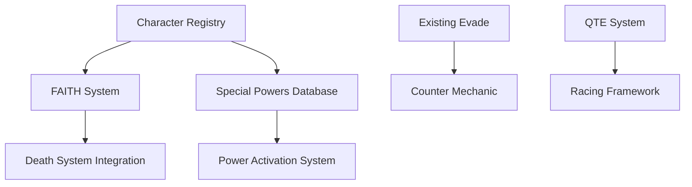

# 🎯 PHASE 2 MECHANICS - TECHNICAL SPECIFICATIONS

**Document Version:** 1.0  
**Last Updated:** 2025-10-08  
**Status:** Ready for Implementation  

---

## 📋 TABLE OF CONTENTS

1. [Counter Mechanic](#1-counter-mechanic)
2. [FAITH System (Lyra's Safeguard)](#2-faith-system-lyras-safeguard)
3. [Special Powers System](#3-special-powers-system)
4. [Racing Mechanic](#4-racing-mechanic)
5. [Technical Considerations](#5-technical-considerations)
6. [Implementation Priority](#6-implementation-priority)
7. [Data Structures](#7-data-structures)
8. [Integration Points](#8-integration-points)

---

## 1. COUNTER MECHANIC

### 1.1 Overview
An evade-based offensive mechanic that allows players to strike back after successfully evading an attack. Creates a dynamic combat flow where defense becomes offense.

### 1.2 Core Mechanics

#### Activation Conditions
- **Trigger:** Successful `*evade*` within timing window
- **Timing Threshold:** Must evade within **first 3 seconds** of QTE start
- **Cooldown:** None (relies on QTE frequency)
- **Command:** `*attack*` (must be used immediately after successful evade)

#### Attack Window
```python
# After successful evade
counter_window_start = evade_timestamp
counter_window_end = evade_timestamp + 2.0  # 2 seconds to use *attack*

# If *attack* used within window
if counter_window_start <= attack_time <= counter_window_end:
    trigger_counter_attack()
```

#### Enemy Stun Mechanics
- **Stun Duration:** Random between 0.5 - 1.0 seconds
- **Effect:** Enemy cannot trigger QTEs during stun
- **Visual Indicator:** "⚡ COUNTER! Enemy stunned for {duration}s"
- **QTE Cancellation:** Next scheduled QTE is cancelled/delayed

### 1.3 Combo Chain System

#### Basic Combo
```
1. Enemy triggers QTE
2. Player evades (within 3s)
3. Player uses *attack* (within 2s of evade)
4. Enemy stunned (0.5-1s)
5. Damage dealt to enemy
6. Player can prepare for next action
```

#### Advanced Combo Potential
- **Evade → Attack → Evade:** Chain counters if multiple QTEs queued
- **Team Combos:** Multiple players can counter simultaneously
- **Stun Stacking:** Multiple counters extend stun duration

### 1.4 QTE Cancellation Logic

```python
# When counter attack succeeds
def cancel_next_qte(qte_id):
    """Cancel or delay the next QTE"""
    if qte_id in self.active_qtes:
        # Mark QTE as cancelled
        self.active_qtes[qte_id]['cancelled'] = True
        # Don't trigger timeout handler
        # Visual: "⚠️ Enemy stunned! QTE delayed..."
    
    # Alternative: Delay instead of cancel
    # self.active_qtes[qte_id]['start'] += timedelta(seconds=stun_duration)
```

### 1.5 Implementation Checklist

**Data Structure:**
- [ ] Add `counter_enabled` flag to player state
- [ ] Add `last_evade_time` timestamp tracking
- [ ] Add `enemy_stunned_until` timestamp to boss/enemy state
- [ ] Add `counter_damage` to player stats

**Functions Needed:**
- [ ] `check_counter_window(user_id, current_time)` → bool
- [ ] `execute_counter_attack(user_id, damage)` → bool
- [ ] `apply_enemy_stun(duration)` → None
- [ ] `is_enemy_stunned()` → bool
- [ ] `cancel_next_qte(qte_id)` → None

**Integration Points:**
- [ ] Modify [`handle_single_qte_response()`](advanced_qte_hp_system_debug.py:1103) to detect `*attack*`
- [ ] Add counter window check after successful evade
- [ ] Integrate with QTE timeout handler to respect stuns
- [ ] Update console output for counter actions

**Balance Values:**
```python
# Configuration constants
COUNTER_EVADE_THRESHOLD = 3.0      # Must evade within 3s
COUNTER_ATTACK_WINDOW = 2.0        # 2s to use *attack*
COUNTER_STUN_MIN = 0.5             # Minimum stun duration
COUNTER_STUN_MAX = 1.0             # Maximum stun duration
COUNTER_DAMAGE_MULTIPLIER = 1.5    # 150% of normal damage
```

---

## 2. FAITH SYSTEM (Lyra's Safeguard)

### 2.1 Overview
A resurrection mechanic activated when a player reaches 0 HP, contingent on having the character "Lyra" registered. Creates dramatic moments of miraculous survival.

### 2.2 Core Mechanics

#### Activation Trigger
```python
# In trigger_death() function
async def trigger_death(self, user_id):
    # Check if Lyra is registered before death sequence
    if self.has_lyra_protection(user_id):
        await self.activate_faith_safeguard(user_id)
        return  # Skip death sequence
    
    # Normal death sequence if no Lyra
    # ... existing death code ...
```

#### Lyra Detection System
```python
def has_lyra_protection(self, user_id):
    """Check if user has Lyra registered"""
    # Check user's registered characters
    if user_id not in self.user_characters:
        return False
    
    user_chars = self.user_characters[user_id]
    
    # Check for "Lyra" (case-insensitive)
    for char_name in user_chars:
        if char_name.lower() == "lyra":
            return True
    
    return False
```

### 2.3 Visual Sequence

#### Step-by-Step Animation
```python
async def activate_faith_safeguard(self, user_id):
    """Dramatic resurrection sequence"""
    channel = self.bot.get_channel(self.qte_channel_id)
    member = channel.guild.get_member(user_id)
    
    # Step 1: Dove emoji (0s)
    await channel.send("🕊️")
    
    # Step 2: Ellipsis (1s delay)
    await asyncio.sleep(1.0)
    await channel.send("...")
    
    # Step 3: Refusal message (2s delay)
    await asyncio.sleep(2.0)
    refusal_msg, gif_url = self.get_refusal_message(member)
    await channel.send(refusal_msg)
    
    # Step 4: GIF (0.5s delay)
    await asyncio.sleep(0.5)
    embed = discord.Embed(color=discord.Color.gold())
    embed.set_image(url=gif_url)
    await channel.send(embed=embed)
    
    # Step 5: Restore HP
    await self.faith_resurrection(user_id)
```

### 2.4 Message Variations

#### Variation Selection
```python
def get_refusal_message(self, member):
    """Randomly select refusal message and GIF"""
    variations = [
        {
            "message": f"But {member.display_name} refused.",
            "gif": "https://i.imgur.com/undertale_refused.gif",
            "source": "Undertale"
        },
        {
            "message": f"{member.display_name} did not succumb.",
            "gif": "https://i.imgur.com/omori_something.gif", 
            "source": "Omori"
        }
    ]
    
    chosen = random.choice(variations)
    return chosen["message"], chosen["gif"]
```

### 2.5 Resurrection Mechanics

#### HP Restoration
```python
async def faith_resurrection(self, user_id):
    """Restore player after FAITH activation"""
    hp_data = self.player_hp[user_id]
    
    # Restore to 30% HP (or configurable amount)
    restore_amount = int(hp_data["max"] * 0.30)
    hp_data["current"] = restore_amount
    hp_data["alive"] = True
    
    # Mark FAITH as used
    hp_data["faith_used"] = True
    
    # Update display
    await self.update_hp_bar_display(user_id)
    
    console.print(f"[gold]🕊️ FAITH activated for {user_id}![/gold]")
```

### 2.6 Usage Limits

#### One-Time vs Multiple Use
**Option A: One-Time Per Event** (Recommended)
```python
# Initialize with FAITH available
self.player_hp[user_id] = {
    "current": 100,
    "max": 100,
    "alive": True,
    "faith_used": False  # Can use FAITH once
}

# In has_lyra_protection()
def has_lyra_protection(self, user_id):
    if not self.has_lyra_character(user_id):
        return False
    
    # Check if already used
    if self.player_hp[user_id].get("faith_used", False):
        return False  # Already used
    
    return True
```

**Option B: Multiple Uses** (Alternative)
```python
# Allow FAITH every time HP reaches 0
# No usage tracking needed
# More forgiving but less dramatic
```

### 2.7 Implementation Checklist

**Data Structure:**
- [ ] Add `faith_used` boolean to player HP data
- [ ] Create `faith_messages` list with variations
- [ ] Store GIF URLs for each variation

**Functions Needed:**
- [ ] `has_lyra_character(user_id)` → bool (check character_registry)
- [ ] `has_lyra_protection(user_id)` → bool (includes usage check)
- [ ] `activate_faith_safeguard(user_id)` → None (main sequence)
- [ ] `get_refusal_message(member)` → (str, str) (message, GIF)
- [ ] `faith_resurrection(user_id)` → None (restore HP)

**Integration Points:**
- [ ] Modify [`trigger_death()`](advanced_qte_hp_system_debug.py:805) to check FAITH first
- [ ] Add Lyra check in [`character_registry`](data/character_registry.json:1)
- [ ] Update HP bar to show FAITH status (🕊️ icon?)
- [ ] Add console logging for FAITH activations

**Configuration:**
```python
# FAITH system settings
FAITH_RESTORE_PERCENT = 0.30       # Restore to 30% HP
FAITH_ONE_TIME_USE = True          # True = once per event
FAITH_LYRA_NAME = "lyra"           # Character name (case-insensitive)

# Message variations
FAITH_MESSAGES = [
    {
        "template": "But {name} refused.",
        "gif": "https://i.imgur.com/undertale.gif"
    },
    {
        "template": "{name} did not succumb.",
        "gif": "https://i.imgur.com/omori.gif"
    }
]
```

---

## 3. SPECIAL POWERS SYSTEM

### 3.1 Overview
Each player has access to 2 unique special powers:
- **Power Slot 1:** Character lore-based ability (tied to registered character)
- **Power Slot 2:** Story-based ability (ET events, narrative unlocks)

### 3.2 Power Architecture

#### Data Structure
```python
# Character registry expansion
self.character_powers = {
    "Lyra": {
        "power_1": {
            "name": "Divine Shield",
            "description": "Block next attack for entire team",
            "cooldown": 120,  # seconds
            "type": "defensive"
        }
    },
    "Doom": {
        "power_1": {
            "name": "Hellfire Barrage",
            "description": "Deal massive damage to all enemies",
            "cooldown": 90,
            "type": "offensive"
        }
    }
    # ... more characters
}

# Player power state
self.player_powers = {
    user_id: {
        "power_1": {
            "name": "Divine Shield",
            "unlocked": True,
            "cooldown_until": None,  # timestamp or None
            "uses_remaining": 1  # per event
        },
        "power_2": {
            "name": "Temporal Shift",
            "unlocked": False,  # Story unlock
            "cooldown_until": None,
            "uses_remaining": 0
        }
    }
}
```

### 3.3 Power Categories

#### Power Slot 1: Character Lore Powers
**Source:** Automatically assigned based on registered character

**Examples:**
```python
CHARACTER_POWERS = {
    "Lyra": {
        "name": "Angelic Blessing",
        "effect": "team_heal",
        "value": 50,
        "cooldown": 120
    },
    "Doom": {
        "name": "Demonic Rage",
        "effect": "damage_boost",
        "value": 2.0,  # 200% damage
        "duration": 30
    },
    "Ryoshu": {
        "name": "Artistic Slash",
        "effect": "guaranteed_crit",
        "duration": 15
    }
}
```

#### Power Slot 2: Story Powers
**Source:** Unlocked through narrative events, achievements, or story progression

**Examples:**
```python
STORY_POWERS = {
    "et_time_dilation": {
        "name": "ET Time Dilation",
        "description": "Slow time for 10 seconds",
        "unlock_condition": "complete_et_event",
        "effect": "extend_qte_windows",
        "multiplier": 2.0
    },
    "narrative_fury": {
        "name": "Narrative Fury",
        "description": "Channel plot armor",
        "unlock_condition": "survive_3_boss_phases",
        "effect": "invincibility",
        "duration": 5
    }
}
```

### 3.4 Activation System

#### Command-Based Activation
```python
# New commands
async def handle_qte_response(self, message):
    content = message.content.lower().strip()
    
    # Check for power activation
    if '*power1*' in content or '*power 1*' in content:
        await self.activate_power(message.author.id, slot=1)
        return
    
    if '*power2*' in content or '*power 2*' in content:
        await self.activate_power(message.author.id, slot=2)
        return
    
    # ... existing QTE handling
```

#### Hotkey Alternative (Future)
```python
# Keyboard shortcuts
keyboard.add_hotkey('f5', lambda: activate_power_slot_1())
keyboard.add_hotkey('f6', lambda: activate_power_slot_2())
```

### 3.5 Power Execution

#### Core Function
```python
async def activate_power(self, user_id, slot):
    """Activate a special power"""
    # Get player power data
    if user_id not in self.player_powers:
        await self.channel.send("❌ You have no powers unlocked!")
        return
    
    power_data = self.player_powers[user_id][f"power_{slot}"]
    
    # Validation checks
    if not power_data["unlocked"]:
        await self.channel.send(f"❌ Power Slot {slot} not unlocked!")
        return
    
    if power_data["cooldown_until"]:
        if datetime.now() < power_data["cooldown_until"]:
            remaining = (power_data["cooldown_until"] - datetime.now()).seconds
            await self.channel.send(f"⏳ Power on cooldown: {remaining}s remaining")
            return
    
    if power_data["uses_remaining"] <= 0:
        await self.channel.send("❌ No uses remaining!")
        return
    
    # Execute power
    await self.execute_power_effect(user_id, slot, power_data)
    
    # Apply cooldown
    cooldown_duration = power_data.get("cooldown", 60)
    power_data["cooldown_until"] = datetime.now() + timedelta(seconds=cooldown_duration)
    power_data["uses_remaining"] -= 1
```

#### Power Effects
```python
async def execute_power_effect(self, user_id, slot, power_data):
    """Execute the actual power effect"""
    effect_type = power_data.get("effect")
    channel = self.bot.get_channel(self.qte_channel_id)
    member = channel.guild.get_member(user_id)
    
    # Create dramatic announcement
    embed = discord.Embed(
        title=f"⚡ {power_data['name']} ACTIVATED! ⚡",
        description=f"**{member.mention}** unleashes their power!",
        color=discord.Color.purple()
    )
    await channel.send(embed=embed)
    
    # Apply effect based on type
    if effect_type == "team_heal":
        await self.power_team_heal(power_data["value"])
    
    elif effect_type == "damage_boost":
        await self.power_damage_boost(user_id, power_data["value"], power_data["duration"])
    
    elif effect_type == "extend_qte_windows":
        await self.power_time_dilation(power_data["multiplier"])
    
    # ... more effect types
```

### 3.6 Power Effect Types

#### Available Effects
```python
POWER_EFFECTS = {
    # Healing
    "team_heal": "Restore HP to all living players",
    "self_heal": "Restore HP to self only",
    "revive": "Resurrect one dead player",
    
    # Offensive
    "damage_boost": "Increase damage output",
    "guaranteed_crit": "Next attacks are critical",
    "boss_damage": "Direct damage to boss",
    
    # Defensive
    "shield": "Block next damage instance",
    "invincibility": "Cannot take damage for duration",
    "dodge_boost": "Increase evade window",
    
    # Utility
    "extend_qte_windows": "Slow time effect",
    "cooldown_reset": "Reset all cooldowns",
    "combo_boost": "Increase combo multiplier"
}
```

### 3.7 Implementation Checklist

**Data Structure:**
- [ ] Create `character_powers` database
- [ ] Create `story_powers` database
- [ ] Add `player_powers` state tracking
- [ ] Design power unlock system

**Functions Needed:**
- [ ] `initialize_player_powers(user_id)` → None
- [ ] `assign_character_power(user_id, character_name)` → None
- [ ] `unlock_story_power(user_id, power_id)` → bool
- [ ] `activate_power(user_id, slot)` → None
- [ ] `execute_power_effect(user_id, slot, power_data)` → None
- [ ] `check_power_cooldown(user_id, slot)` → bool
- [ ] `power_team_heal(amount)` → None
- [ ] `power_damage_boost(user_id, multiplier, duration)` → None

**Integration Points:**
- [ ] Modify [`handle_qte_response()`](advanced_qte_hp_system_debug.py:1060) to detect `*power1*` and `*power2*`
- [ ] Add power info to [`/mystats`](advanced_qte_hp_system_debug.py:421) command
- [ ] Create `/powers` command to view available powers
- [ ] Update character registration to assign Power Slot 1
- [ ] Create admin command to grant story powers

**Configuration:**
```python
# Power system settings
POWER_MAX_USES_PER_EVENT = 1       # Limit uses per event
POWER_DEFAULT_COOLDOWN = 60        # Default cooldown in seconds
POWER_ANNOUNCE_USAGE = True        # Announce in channel

# Auto-assign power on character registration
AUTO_ASSIGN_CHARACTER_POWER = True
```

---

## 4. RACING MECHANIC

### 4.1 Overview
A speed-based mechanic for chase and escape sequences. Players accumulate distance through successful QTE responses, competing against enemies or racing toward checkpoints.

### 4.2 Core Mechanics

#### Racing Mode Types

**Type A: CHASE (Escape from Enemy)**
```python
race_config = {
    "type": "chase",
    "goal_distance": 1000,  # meters
    "enemy_speed": 10,      # m/s base speed
    "catch_distance": 50,   # If enemy gets within 50m, you're caught
    "duration": 120         # 2 minute time limit
}
```

**Type B: ESCAPE (Outrun the Enemy)**
```python
race_config = {
    "type": "escape",
    "safe_distance": 500,   # Must reach 500m ahead
    "enemy_speed": 8,
    "boost_available": True,
    "duration": 90
}
```

**Type C: CHECKPOINT (Reach Destination)**
```python
race_config = {
    "type": "checkpoint",
    "checkpoints": [200, 500, 800, 1000],
    "checkpoint_rewards": [10, 15, 20, 30],  # HP heals
    "time_limits": [30, 60, 90, 120]         # Seconds per checkpoint
}
```

### 4.3 Vehicle System

#### Vehicle Types
```python
RACING_VEHICLES = {
    "default": {
        "name": "On Foot",
        "base_speed": 5,        # m/s
        "qte_multiplier": 1.0,
        "special_ability": None
    },
    "motorcycle": {
        "name": "Motorcycle",
        "base_speed": 15,
        "qte_multiplier": 1.5,
        "special_ability": "boost"  # Double speed for 5s
    },
    "car": {
        "name": "Combat Car",
        "base_speed": 12,
        "qte_multiplier": 1.3,
        "special_ability": "ram"    # Damage enemy if close
    },
    "jet": {
        "name": "Fighter Jet",
        "base_speed": 30,
        "qte_multiplier": 2.0,
        "special_ability": "afterburner"
    }
}
```

#### Character-Based Foot Racing
```python
# Special characters with high foot speed
FOOT_RACING_CHARACTERS = {
    "Uma Musume Characters": {
        "base_speed": 12,  # Faster than default
        "stamina": 150,    # Can maintain speed longer
        "special": "sprint"  # Temporary speed burst
    }
    # Add more running-capable characters
}
```

### 4.4 Speed Accumulation System

#### Distance Calculation
```python
class RaceState:
    def __init__(self, race_type, goal_distance):
        self.race_type = race_type
        self.goal_distance = goal_distance
        self.start_time = datetime.now()
        
        # Player positions
        self.player_distances = {}  # {user_id: distance_traveled}
        self.enemy_distance = 0
        
        # Race configuration
        self.active = True
        self.winner = None

async def handle_racing_qte(self, message, user_id):
    """Handle QTE responses during race"""
    if not self.race_state or not self.race_state.active:
        return
    
    # Check QTE response
    if '*evade*' in message.content.lower():
        # Successful evade = maintain speed
        distance_gained = self.calculate_evade_distance(user_id)
        self.race_state.player_distances[user_id] += distance_gained
    
    elif '*boost*' in message.content.lower():
        # Speed boost
        distance_gained = self.calculate_boost_distance(user_id)
        self.race_state.player_distances[user_id] += distance_gained
    
    # Update race status
    await self.update_race_display()
    await self.check_race_completion()
```

#### Speed Calculation
```python
def calculate_evade_distance(self, user_id, response_time):
    """Calculate distance based on QTE performance"""
    # Get vehicle/character speed
    vehicle = self.player_vehicles.get(user_id, "default")
    base_speed = RACING_VEHICLES[vehicle]["base_speed"]
    
    # QTE quality affects distance
    if response_time < 1.0:
        quality_multiplier = 1.5  # Perfect timing
    elif response_time < 2.0:
        quality_multiplier = 1.2  # Good timing
    else:
        quality_multiplier = 1.0  # Adequate timing
    
    # Calculate distance
    time_window = 3.0  # 3 seconds per QTE
    distance = base_speed * time_window * quality_multiplier
    
    return distance
```

### 4.5 Race Visualization

#### Live Race Display
```python
async def update_race_display(self):
    """Update race progress in channel"""
    embed = discord.Embed(
        title="🏁 RACE IN PROGRESS",
        description=f"Goal: {self.race_state.goal_distance}m",
        color=discord.Color.blue()
    )
    
    # Show player positions
    for user_id, distance in self.race_state.player_distances.items():
        member = self.guild.get_member(user_id)
        progress_percent = (distance / self.race_state.goal_distance) * 100
        progress_bar = self.create_progress_bar(progress_percent)
        
        embed.add_field(
            name=f"🏃 {member.display_name}",
            value=f"{progress_bar} {distance:.0f}m ({progress_percent:.1f}%)",
            inline=False
        )
    
    # Show enemy position if chase mode
    if self.race_state.race_type == "chase":
        enemy_percent = (self.race_state.enemy_distance / self.race_state.goal_distance) * 100
        enemy_bar = self.create_progress_bar(enemy_percent)
        embed.add_field(
            name="👹 Enemy",
            value=f"{enemy_bar} {self.race_state.enemy_distance:.0f}m",
            inline=False
        )
    
    await self.channel.send(embed=embed)
```

#### Progress Bar Creation
```python
def create_progress_bar(self, percent, length=20):
    """Create visual progress bar"""
    filled = int((percent / 100) * length)
    empty = length - filled
    
    bar = "█" * filled + "░" * empty
    return f"[{bar}]"
```

### 4.6 Race Completion

#### Win Conditions
```python
async def check_race_completion(self):
    """Check if race is complete"""
    # Player wins
    for user_id, distance in self.race_state.player_distances.items():
        if distance >= self.race_state.goal_distance:
            await self.trigger_race_victory(user_id)
            return
    
    # Enemy catches up (chase mode)
    if self.race_state.race_type == "chase":
        for user_id, distance in self.race_state.player_distances.items():
            gap = distance - self.race_state.enemy_distance
            if gap <= 50:  # Enemy caught player
                await self.trigger_race_defeat(user_id, "caught")
                return
    
    # Time limit exceeded
    elapsed = (datetime.now() - self.race_state.start_time).seconds
    if elapsed >= self.race_state.duration:
        await self.trigger_race_timeout()
```

#### Victory/Defeat Messages
```python
async def trigger_race_victory(self, user_id):
    """Player wins the race"""
    member = self.guild.get_member(user_id)
    
    embed = discord.Embed(
        title="🏆 RACE COMPLETE!",
        description=f"**{member.mention}** reached the finish line!",
        color=discord.Color.gold()
    )
    
    # Rewards
    reward_hp = 30
    await self.heal_player(user_id, reward_hp)
    embed.add_field(name="Reward", value=f"+{reward_hp} HP")
    
    await self.channel.send(embed=embed)
    self.race_state.active = False
```

### 4.7 Implementation Checklist

**Data Structure:**
- [ ] Create `RaceState` class for race tracking
- [ ] Add `player_vehicles` dictionary
- [ ] Create `RACING_VEHICLES` configuration
- [ ] Add `FOOT_RACING_CHARACTERS` for special characters

**Functions Needed:**
- [ ] `start_race(race_type, config)` → None
- [ ] `handle_racing_qte(message, user_id)` → None
- [ ] `calculate_evade_distance(user_id, response_time)` → float
- [ ] `calculate_boost_distance(user_id)` → float
- [ ] `update_enemy_position(time_delta)` → None
- [ ] `update_race_display()` → None
- [ ] `check_race_completion()` → None
- [ ] `trigger_race_victory(user_id)` → None
- [ ] `trigger_race_defeat(user_id, reason)` → None
- [ ] `assign_vehicle(user_id, vehicle_type)` → None

**Integration Points:**
- [ ] Add race mode detection to [`handle_qte_response()`](advanced_qte_hp_system_debug.py:1060)
- [ ] Create admin command `/startrace` for race initialization
- [ ] Add hotkey for starting races (F4?)
- [ ] Track race statistics in player stats
- [ ] Update HP bars during races

**Configuration:**
```python
# Racing system settings
RACE_DEFAULT_GOAL = 1000           # Default goal distance (meters)
RACE_ENEMY_BASE_SPEED = 10         # Enemy speed (m/s)
RACE_CATCH_DISTANCE = 50           # Distance for "caught"
RACE_DEFAULT_DURATION = 120        # Time limit (seconds)
RACE_CHECKPOINT_HEAL = 20          # HP per checkpoint
RACE_QTE_INTERVAL = 5              # Seconds between race QTEs
```

---

## 5. TECHNICAL CONSIDERATIONS

### 5.1 State Management

#### New State Variables
```python
class AdvancedQTEBot:
    def __init__(self):
        # ... existing init ...
        
        # Counter system
        self.counter_enabled = {}  # {user_id: timestamp}
        self.enemy_stunned_until = None
        
        # FAITH system
        self.faith_messages = [...]  # Message variations
        
        # Powers system
        self
.player_powers = {}
        self.character_powers = {}
        
        # Racing system
        self.race_state = None
        self.player_vehicles = {}
```

#### State Persistence
```python
def save_all_data(self):
    """Enhanced save with new systems"""
    save_data("character_registry", self.character_registry)
    save_data("user_characters", self.user_characters)
    save_data("player_stats", self.player_stats)
    
    # New saves
    save_data("player_powers", self.player_powers)
    save_data("character_powers", self.character_powers)
    save_data("player_vehicles", self.player_vehicles)
```

### 5.2 Integration with Existing HP System

#### HP System Hooks
```python
# In damage_player()
async def damage_player(self, user_id, difficulty):
    """Modified to check FAITH before death"""
    # ... existing damage calculation ...
    
    # Check if player died
    if hp_data["current"] == 0:
        # NEW: Check FAITH system first
        if self.has_lyra_protection(user_id):
            await self.activate_faith_safeguard(user_id)
            return True  # Survived
        
        # Normal death
        await self.trigger_death(user_id)
        return False
```

#### Counter Integration with QTE System
```python
# In handle_single_qte_response()
async def handle_single_qte_response(self, qte_id, qte_data, ...):
    # ... existing evade check ...
    
    if '*evade*' in content:
        if response_time <= evade_window:
            # SUCCESS - Enable counter
            self.counter_enabled[user_id] = time.time()
            responses.add(user_id)
            await channel.send(f"✅ {message.author.mention} **evaded!** Type *attack* to counter!")
            # ... rest of evade logic ...
    
    # NEW: Check for counter attack
    elif '*attack*' in content:
        await self.handle_counter_attack(user_id, qte_id, qte_data, message)
```

### 5.3 Character Registry Expansion

#### Enhanced Character Data
```python
# Expanded character registry structure
self.character_registry = {
    "character_name": {
        "user_id": 123456789,
        "power_slot_1": {
            "name": "Divine Shield",
            "type": "defensive",
            "cooldown": 120
        },
        "can_race_on_foot": False,  # True for Uma Musume characters
        "base_speed": 5,  # Default foot speed
        "special_traits": []  # ["fast_runner", "combat_expert"]
    }
}
```

### 5.4 Lyra Detection System

#### Case-Insensitive Character Matching
```python
def has_lyra_character(self, user_id):
    """Check if user has Lyra registered (case-insensitive)"""
    if user_id not in self.user_characters:
        return False
    
    user_chars = self.user_characters[user_id]
    
    # Check for Lyra (any case variation)
    lyra_variants = ["lyra", "LYRA", "Lyra"]
    for char_name in user_chars:
        if char_name.lower() in [v.lower() for v in lyra_variants]:
            return True
    
    return False
```

### 5.5 Race State Tracking

#### Race State Manager
```python
class RaceState:
    """Manages active race state"""
    def __init__(self, race_type, config):
        self.race_type = race_type  # "chase", "escape", "checkpoint"
        self.goal_distance = config["goal_distance"]
        self.start_time = datetime.now()
        self.active = True
        
        # Player tracking
        self.player_distances = {}  # {user_id: distance}
        self.player_vehicles = {}   # {user_id: vehicle_type}
        
        # Enemy tracking (for chase/escape)
        self.enemy_distance = 0
        self.enemy_speed = config.get("enemy_speed", 10)
        
        # Checkpoint tracking
        self.checkpoints = config.get("checkpoints", [])
        self.checkpoints_reached = {}  # {user_id: [checkpoint_indices]}
        
        # Results
        self.winner = None
        self.completion_time = None
    
    def update_enemy_position(self, time_delta):
        """Update enemy position based on elapsed time"""
        self.enemy_distance += self.enemy_speed * time_delta
    
    def get_player_progress(self, user_id):
        """Get player's progress percentage"""
        distance = self.player_distances.get(user_id, 0)
        return (distance / self.goal_distance) * 100
```

---

## 6. IMPLEMENTATION PRIORITY

### 6.1 Priority Ranking

#### Phase 2A: Core Combat Enhancements (Week 1-2)
**Priority: CRITICAL** - Completes combat triangle

1. **COUNTER MECHANIC** ⭐⭐⭐
   - Estimated Time: 3-4 hours
   - Dependencies: None (extends existing evade)
   - Impact: High (adds offensive option)
   - Complexity: Medium

2. **FAITH SYSTEM** ⭐⭐⭐
   - Estimated Time: 2-3 hours
   - Dependencies: Character registry
   - Impact: High (death prevention is crucial)
   - Complexity: Low

#### Phase 2B: Power Systems (Week 2-3)
**Priority: HIGH** - Adds strategic depth

3. **SPECIAL POWERS (Database Structure)** ⭐⭐
   - Estimated Time: 4-5 hours
   - Dependencies: Character registry expansion
   - Impact: Medium (needs content population)
   - Complexity: High

4. **SPECIAL POWERS (Activation System)** ⭐⭐
   - Estimated Time: 3-4 hours
   - Dependencies: Power database
   - Impact: Medium
   - Complexity: Medium

#### Phase 2C: Advanced Mechanics (Week 3-4)
**Priority: MEDIUM** - Enhances gameplay variety

5. **RACING FRAMEWORK** ⭐
   - Estimated Time: 6-8 hours
   - Dependencies: New state management system
   - Impact: Medium (event-specific)
   - Complexity: Very High

### 6.2 Implementation Dependencies



### 6.3 Testing Requirements

#### Per-Mechanic Testing
```python
# Counter Mechanic Tests
- [ ] Evade enables counter window
- [ ] *attack* only works within 2s of evade
- [ ] Enemy stun prevents next QTE
- [ ] Stun duration randomizes (0.5-1s)
- [ ] Console logs counter actions
- [ ] Stats track counter damage

# FAITH System Tests
- [ ] Lyra detection works (case-insensitive)
- [ ] Death triggers FAITH sequence
- [ ] Visual sequence displays correctly (dove, ..., message, GIF)
- [ ] HP restores to 30%
- [ ] One-time use prevents repeated activation
- [ ] Non-Lyra characters still die normally

# Special Powers Tests
- [ ] Powers assigned on character registration
- [ ] Power activation detects *power1* / *power2*
- [ ] Cooldown system prevents spam
- [ ] Uses remaining tracked correctly
- [ ] Effects apply properly (heal, damage, etc.)
- [ ] Power unlocks save/load correctly

# Racing Mechanic Tests
- [ ] Race initializes with correct config
- [ ] Distance accumulates with QTE success
- [ ] Enemy position updates over time
- [ ] Progress bars display correctly
- [ ] Win/lose conditions trigger properly
- [ ] Vehicle bonuses apply correctly
- [ ] Character foot speed modifiers work
```

### 6.4 Rollback Strategy

#### Incremental Implementation
```python
# Feature flags for easy disable
FEATURE_FLAGS = {
    "counter_mechanic": True,
    "faith_system": True,
    "special_powers": False,  # Disable if buggy
    "racing_mechanic": False  # Disable until tested
}

# In code
if FEATURE_FLAGS["counter_mechanic"]:
    # Counter logic
    pass
```

---

## 7. DATA STRUCTURES

### 7.1 Enhanced Player State

```python
self.player_hp = {
    user_id: {
        # Existing
        "current": 100,
        "max": 100,
        "alive": True,
        "revenge_mode": False,
        
        # NEW: FAITH system
        "faith_available": True,      # Has Lyra registered
        "faith_used": False,          # Used FAITH this event
        
        # NEW: Counter system
        "counter_enabled_until": None,  # Timestamp or None
        "counter_damage": 0,            # Total counter damage dealt
        
        # NEW: Powers
        "active_buffs": [],             # List of active buff effects
        "power_cooldowns": {
            "power_1": None,            # Timestamp or None
            "power_2": None
        }
    }
}
```

### 7.2 Character Powers Database

```python
self.character_powers = {
    "Lyra": {
        "name": "Angelic Blessing",
        "description": "Heal entire team for 50 HP",
        "type": "healing",
        "effect": {
            "action": "team_heal",
            "value": 50
        },
        "cooldown": 120,
        "uses_per_event": 1,
        "icon": "🕊️"
    },
    
    "Doom": {
        "name": "Infernal Barrage",
        "description": "Deal 200 damage to all enemies",
        "type": "offensive",
        "effect": {
            "action": "aoe_damage",
            "value": 200
        },
        "cooldown": 90,
        "uses_per_event": 2,
        "icon": "🔥"
    },
    
    "Ryoshu": {
        "name": "Brushstroke",
        "description": "Next 3 attacks are critical hits",
        "type": "buff",
        "effect": {
            "action": "guarantee_crits",
            "count": 3
        },
        "cooldown": 60,
        "uses_per_event": 3,
        "icon": "🖌️"
    }
}
```

### 7.3 Story Powers Database

```python
self.story_powers = {
    "et_temporal_shift": {
        "name": "ET's Temporal Shift",
        "description": "Extend all QTE windows by 2x for 10 seconds",
        "unlock_condition": "complete_et_event",
        "type": "utility",
        "effect": {
            "action": "extend_windows",
            "multiplier": 2.0,
            "duration": 10
        },
        "cooldown": 180,
        "uses_per_event": 1,
        "icon": "⏰"
    },
    
    "narrative_armor": {
        "name": "Plot Armor",
        "description": "Become invincible for 5 seconds",
        "unlock_condition": "survive_10_revenge_activations",
        "type": "defensive",
        "effect": {
            "action": "invincibility",
            "duration": 5
        },
        "cooldown": 300,
        "uses_per_event": 1,
        "icon": "🛡️"
    }
}
```

### 7.4 Race State Structure

```python
self.race_state = {
    "active": True,
    "type": "chase",  # or "escape", "checkpoint"
    "start_time": datetime.now(),
    
    # Configuration
    "goal_distance": 1000,
    "duration": 120,
    "enemy_speed": 10,
    
    # Tracking
    "players": {
        user_id: {
            "distance": 250,
            "vehicle": "motorcycle",
            "checkpoints_reached": [1, 2],
            "last_qte_time": datetime.now(),
            "speed_boosts_used": 1
        }
    },
    
    "enemy_distance": 150,
    "checkpoints": [200, 500, 800, 1000],
    
    # Results
    "winner": None,
    "completion_time": None,
    "final_standings": []
}
```

### 7.5 Counter State Tracking

```python
self.counter_windows = {
    user_id: {
        "evade_time": 1234567890.123,    # Timestamp of successful evade
        "window_end": 1234567892.123,     # Timestamp when counter expires
        "qte_id": 5,                      # Associated QTE
        "damage_multiplier": 1.5          # Counter damage bonus
    }
}

self.enemy_stun = {
    "active": True,
    "until": datetime.now() + timedelta(seconds=0.75),
    "stunned_by": user_id,
    "cancelled_qtes": [6, 7]  # QTE IDs that were cancelled
}
```

---

## 8. INTEGRATION POINTS

### 8.1 Existing Function Modifications

#### [`handle_qte_response()`](advanced_qte_hp_system_debug.py:1060)
```python
async def handle_qte_response(self, message):
    """Enhanced with new mechanics"""
    content = message.content.lower().strip()
    
    # NEW: Check for power activation
    if '*power1*' in content or '*power 1*' in content:
        await self.activate_power(message.author.id, 1)
        return
    
    if '*power2*' in content or '*power 2*' in content:
        await self.activate_power(message.author.id, 2)
        return
    
    # NEW: Check for counter attack
    if '*attack*' in content:
        await self.handle_counter_attack(message.author.id)
        return
    
    # NEW: Check for racing mode
    if self.race_state and self.race_state.active:
        await self.handle_racing_qte(message, message.author.id)
        return
    
    # Existing QTE handling
    # ... evade, parry, save logic ...
```

#### [`trigger_death()`](advanced_qte_hp_system_debug.py:805)
```python
async def trigger_death(self, user_id):
    """Modified to check FAITH first"""
    # NEW: Check FAITH system
    if self.has_lyra_protection(user_id):
        await self.activate_faith_safeguard(user_id)
        return  # Survived via FAITH
    
    # Existing death sequence
    hp_data = self.player_hp.get(user_id)
    hp_data["alive"] = False
    
    await channel.send("🕊️")
    # ... rest of death sequence ...
```

#### [`initialize_player_hp()`](advanced_qte_hp_system_debug.py:593)
```python
async def initialize_player_hp(self, user_id):
    """Enhanced with new systems"""
    if user_id not in self.player_hp:
        self.player_hp[user_id] = {
            "current": self.max_hp,
            "max": self.max_hp,
            "alive": True,
            "revenge_mode": False,
            
            # NEW fields
            "faith_available": self.has_lyra_character(user_id),
            "faith_used": False,
            "counter_enabled_until": None,
            "counter_damage": 0,
            "active_buffs": [],
            "power_cooldowns": {"power_1": None, "power_2": None}
        }
        
        # NEW: Initialize powers
        await self.initialize_player_powers(user_id)
        
        await self.update_hp_bar_display(user_id)
```

### 8.2 New Slash Commands

#### `/powers` Command
```python
@self.bot.tree.command(name="powers", description="View your special powers")
async def powers_command(interaction: discord.Interaction):
    user_id = interaction.user.id
    
    if user_id not in self.player_powers:
        await interaction.response.send_message(
            "❌ You have no powers unlocked!",
            ephemeral=True
        )
        return
    
    powers = self.player_powers[user_id]
    
    embed = discord.Embed(
        title=f"⚡ {interaction.user.display_name}'s Powers",
        color=discord.Color.purple()
    )
    
    # Power Slot 1
    p1 = powers["power_1"]
    if p1["unlocked"]:
        status = "✅ Ready" if not p1["cooldown_until"] else f"⏳ Cooldown"
        embed.add_field(
            name=f"🔷 Power Slot 1: {p1['name']}",
            value=f"{p1['description']}\nStatus: {status}\nUses: {p1['uses_remaining']}",
            inline=False
        )
    
    # Power Slot 2
    p2 = powers["power_2"]
    if p2["unlocked"]:
        status = "✅ Ready" if not p2["cooldown_until"] else f"⏳ Cooldown"
        embed.add_field(
            name=f"🔶 Power Slot 2: {p2['name']}",
            value=f"{p2['description']}\nStatus: {status}\nUses: {p2['uses_remaining']}",
            inline=False
        )
    else:
        embed.add_field(
            name="🔶 Power Slot 2: Locked",
            value="Complete story events to unlock",
            inline=False
        )
    
    await interaction.response.send_message(embed=embed, ephemeral=True)
```

#### `/startrace` Command (Admin)
```python
@self.bot.tree.command(name="startrace", description="[ADMIN] Start a racing sequence")
async def startrace_command(
    interaction: discord.Interaction,
    race_type: str,  # "chase", "escape", "checkpoint"
    goal_distance: int = 1000,
    enemy_speed: int = 10
):
    # Check admin permission
    if self.admin_role_id and self.admin_role_id not in [role.id for role in interaction.user.roles]:
        await interaction.response.send_message("❌ Admin only!", ephemeral=True)
        return
    
    # Initialize race
    config = {
        "goal_distance": goal_distance,
        "enemy_speed": enemy_speed,
        "duration": 120
    }
    
    await self.start_race(race_type, config)
    
    await interaction.response.send_message(
        f"🏁 {race_type.upper()} race started! Goal: {goal_distance}m",
        ephemeral=True
    )
```

### 8.3 Hotkey Additions

```python
def setup_hotkeys(self):
    """Enhanced hotkey setup"""
    # ... existing hotkeys ...
    
    # NEW: Racing hotkeys
    keyboard.add_hotkey('f4', lambda: self.quick_start_chase_race())
    
    # NEW: Power system hotkeys (for admin testing)
    keyboard.add_hotkey('ctrl+f5', lambda: self.test_power_system())
```

### 8.4 Console Output Enhancements

```python
# Counter action logging
console.print(Panel.fit(
    f"[bold yellow]⚡ COUNTER ATTACK![/bold yellow]\n"
    f"[cyan]{player_name}[/cyan] counters with [red]{damage}[/red] damage!\n"
    f"[yellow]Enemy stunned for {stun_duration:.1f}s[/yellow]",
    border_style="yellow"
))

# FAITH activation logging
console.print(Panel.fit(
    f"[bold gold]🕊️ FAITH ACTIVATED[/bold gold]\n"
    f"[cyan]{player_name}[/cyan] refused to die!\n"
    f"[green]HP restored to {hp_restored}[/green]",
    border_style="gold"
))

# Power usage logging
console.print(Panel.fit(
    f"[bold purple]⚡ POWER ACTIVATED[/bold purple]\n"
    f"[cyan]{player_name}[/cyan] used [magenta]{power_name}[/magenta]!\n"
    f"[yellow]Effect: {effect_description}[/yellow]",
    border_style="purple"
))
```

---

## 9. QUESTIONS & CLARIFICATIONS NEEDED

### 9.1 Counter Mechanic
- [ ] Should counter damage scale with difficulty?
- [ ] Can multiple players counter the same QTE?
- [ ] Does counter reset combo chains or continue them?

### 9.2 FAITH System
- [ ] Confirm one-time use vs unlimited
- [ ] Should FAITH restore percentage be configurable?
- [ ] Can FAITH activate during REVENGE mode?
- [ ] Should there be a visual indicator (HP bar icon) showing FAITH availability?

### 9.3 Special Powers
- [ ] Complete character power list needed
- [ ] Story power unlock conditions details
- [ ] Should powers have resource costs (HP, FAITH, etc.)?
- [ ] Can powers be upgraded/leveled up?

### 9.4 Racing Mechanic
- [ ] Priority: Is racing critical for current events?
- [ ] Vehicle system: Should this be simplified?
- [ ] Character-specific racing: Which characters qualify?
- [ ] Integration with boss fights: Racing during combat?

---

## 10. SUCCESS CRITERIA

### 10.1 Counter Mechanic
✅ **Complete When:**
- Evade enables 2-second attack window
- `*attack*` command triggers counter
- Enemy stuns for 0.5-1s
- Next QTE cancelled during stun
- Console logs all counter actions
- Stats track counter damage

### 10.2 FAITH System
✅ **Complete When:**
- Lyra detection works (case-insensitive)
- Death triggers FAITH for Lyra owners
- Visual sequence executes (dove → ... → message → GIF)
- HP restores to configurable percentage
- One-time use enforced
- HP bar shows FAITH status

### 10.3 Special Powers
✅ **Complete When:**
- Powers auto-assign on character registration
- `*power1*` and `*power2*` commands work
- Cooldown system prevents spam
- All effect types functional (heal, damage, buff)
- `/powers` command displays status
- Powers persist across sessions

### 10.4 Racing Mechanic
✅ **Complete When:**
- Race initializes via command/hotkey
- Distance accumulates with QTE success
- Progress bars display in real-time
- Win/lose conditions trigger
- Rewards distribute properly
- Race stats tracked

---

## 11. IMPLEMENTATION ROADMAP

### Week 1: Foundation
- **Days 1-2:** Counter mechanic implementation
- **Days 3-4:** FAITH system implementation
- **Day 5:** Testing and bug fixes

### Week 2: Power Systems
- **Days 1-2:** Character powers database
- **Days 3-4:** Power activation system
- **Day 5:** Power effects implementation

### Week 3: Advanced Features
- **Days 1-3:** Racing framework (if prioritized)
- **Days 4-5:** Integration testing

### Week 4: Polish & Documentation
- **Days 1-2:** Bug fixes and optimization
- **Days 3-4:** User documentation updates
- **Day 5:** Final testing and deployment

---

## 12. MAINTENANCE CONSIDERATIONS

### 12.1 Balance Tuning
```python
# Easily adjustable constants
BALANCE_CONFIG = {
    "counter": {
        "damage_multiplier": 1.5,
        "stun_min": 0.5,
        "stun_max": 1.0,
        "attack_window": 2.0
    },
    "faith": {
        "restore_percent": 0.30,
        "one_time_use": True
    },
    "powers": {
        "default_cooldown": 60,
        "max_uses_per_event": 1
    },
    "racing": {
        "base_speed": 5,
        "qte_distance_mult": 1.0
    }
}
```

### 12.2 Feature Toggles
```python
# Easy enable/disable for production
FEATURE_ENABLED = {
    "counter_mechanic": True,
    "faith_system": True,
    "special_powers": False,  # Not ready yet
    "racing_mechanic": False  # Still in development
}
```

### 12.3 Monitoring & Logging
```python
# Track usage statistics
self.mechanic_stats = {
    "counters_used": 0,
    "faith_activations": 0,
    "powers_activated": 0,
    "races_completed": 0
}

# Log to file for analysis
log.info(f"Counter used by {user_id}, damage: {damage}")
log.info(f"FAITH activated for {user_id}, HP restored: {hp}")
log.info(f"Power {power_name} used by {user_id}")
```

---

## 13. CONCLUSION

This technical specification provides complete implementation details for Phase 2 mechanics. All systems are designed to integrate seamlessly with the existing codebase while maintaining modularity for future expansion.

**Recommended First Steps:**
1. Implement Counter Mechanic (highest impact, lowest complexity)
2. Implement FAITH System (critical death prevention)
3. Build Power System database structure
4. Consider Racing Mechanic complexity vs. current priority

**Code Mode is ready to begin implementation when approved.** 🚀

---

**Document End**